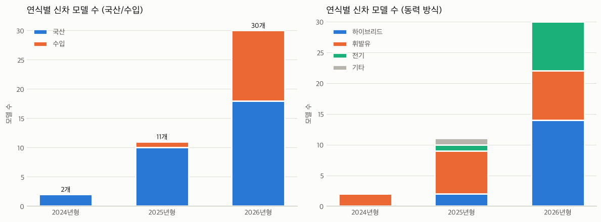
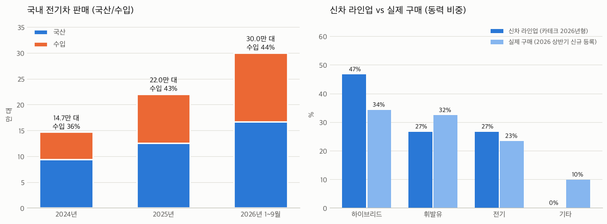

# 국내 전기차 신차·구매 동향 분석 보고서

- **작성일**: 2026-10-29
- **분석 대상**: 네이트 카테크(cartech.nate.com) 신차 라인업·뉴스 + 공식 판매·등록 통계 + 언론·커뮤니티 이슈
- **분석 노트북**: `cartech_전기차_리스트.ipynb` (질문 1~6)

---

## 요약

1. **신차는 2026년형에 몰려 있고, 수입 비중이 크게 늘었다.** 2024~2026년형 43개 모델 중 30개가 2026년형이며, 수입 비중은 2025년형 9%에서 2026년형 40%로 늘었다.
2. **전기차 신차는 수입이, 하이브리드 신차는 국산이 주도한다.** 전기차 모델 9개 중 6개가 수입이고, 국산(기아·현대)은 하이브리드 위주다.
3. **전기차 구매는 빠르게 늘고 있다.** 판매량은 14.7만 대(2024) → 22.0만 대(2025)였고, 2026년에는 9개월 만에 30.0만 대로 작년 전체를 넘었다. 신규 등록 중 전기차 비중은 13%에서 23%로 늘었다.
4. **구매도 수입 쪽으로 옮겨가고 있다.** 전기차 수입 비중은 36% → 43% → 44%로 늘었고, 2026년 9월에는 57%로 처음 국산을 넘었다.
5. **소비자는 화재·충전·비용을 걱정하지만, 업계 뉴스는 이를 거의 다루지 않는다.** 카테크 뉴스 147개 중 화재 기사는 1개, 보조금·충전요금 기사는 0개였다.

---

## 1. 데이터 개요

| 데이터 | 출처 | 기간·기준 | 규모 | 주요 항목 |
|---|---|---|---|---|
| 신차 라인업 | 카테크 인기 차종 5개 탭 (세단·SUV·전기차·하이브리드·수입차) | 2026-10-29 저장본 | 114행 → 중복 제거 62개 모델 | 브랜드, 모델, 연식, 동력, 월렌트료 |
| 뉴스 | 카테크 뉴스 (모터트렌드 기사) | 2025-03 ~ 2026-10 | 147개 (날짜 있는 기사 111개) | 날짜, 제목, 요약, 탭 |
| 판매·등록 통계 | KAMA·국토교통부·KAIDA (기사에 인용된 수치) | 2024 ~ 2026년 9월 | 연도별 요약 수치 | 전기차 판매(국산/수입), 연료별 신규 등록 |
| 언론·커뮤니티 이슈 | 웹 검색 | 2024 ~ 2026-10 | 기사·글 약 20건 | 화재, 충전요금, 보조금, 지하주차장 |

**카테크 사이트의 성격**
- 네이트 × 다타랩이 운영하는 **신차 장기렌트 판매 사이트**다.
- 뉴스 기사는 모두 자동차 잡지 **모터트렌드** 한 곳에서 온다.

---

## 2. 신차 분포 (2024·2025·2026년형)

> 카테크에서 현재 판매 중인 차의 연식(년형)을 기준으로 했다. 연식을 출시 연도에 가까운 값으로 보았다.

### 2-1. 연식별 국산/수입

| 연식 | 국산 | 수입 | 합계 | 수입 비중 |
|---|---|---|---|---|
| 2024년형 | 2 | 0 | 2 | 0% |
| 2025년형 | 10 | 1 | 11 | 9% |
| 2026년형 | 18 | 12 | 30 | **40%** |
| **합계** | 30 | 13 | 43 | 30% |

### 2-2. 연식별 동력 방식

| 연식 | 하이브리드 | 휘발유 | 전기 | 기타(디젤 등) | 합계 |
|---|---|---|---|---|---|
| 2024년형 | 0 | 2 | 0 | 0 | 2 |
| 2025년형 | 2 | 7 | 1 | 1 | 11 |
| 2026년형 | **14** | 8 | 8 | 0 | 30 |
| **합계** | 16 | 17 | 9 | 1 | 43 |

### 2-3. 브랜드별 (2024~2026년형)

| 구분 | 브랜드 | 하이브리드 | 휘발유 | 전기 | 기타 | 모델 수 |
|---|---|---|---|---|---|---|
| 국산 | 기아 | 7 | 3 | 2 | 0 | 12 |
| 국산 | 현대 | 5 | 4 | 1 | 0 | 10 |
| 국산 | 제네시스 | 0 | 5 | 0 | 0 | 5 |
| 국산 | KGM | 0 | 1 | 0 | 0 | 1 |
| 국산 | 르노코리아 | 1 | 0 | 0 | 0 | 1 |
| 국산 | 쉐보레 | 0 | 1 | 0 | 0 | 1 |
| 수입 | BMW | 2 | 1 | 0 | 1 | 4 |
| 수입 | BYD | 1 | 0 | 1 | 0 | 2 |
| 수입 | 벤츠 | 0 | 2 | 0 | 0 | 2 |
| 수입 | 테슬라 | 0 | 0 | 2 | 0 | 2 |
| 수입 | 폭스바겐 | 0 | 0 | 2 | 0 | 2 |
| 수입 | 폴스타 | 0 | 0 | 1 | 0 | 1 |

### 2-4. 뉴스로 본 신차 출시

| 연도 | 국산 | 수입 | 합계 | 그중 전기차 |
|---|---|---|---|---|
| 2024 | 0 | 0 | 0 | 0 |
| 2025 | 0 | 0 | 0 | 0 |
| 2026 (9~10월) | 5 | 11 | 16 | 5 |

- 2024년 기사는 사이트에 없다. 2025년 기사는 신차 소식이 아니라 칼럼과 시승기뿐이다.
- 2026년 전기차 신차 기사 5개 중 4개가 수입 브랜드다. 벤츠 CLA·GLC·GLB, BMW i5·iX 한정판, 시트로엥 2 CV 콘셉트가 여기에 해당한다. 국산은 제네시스 GV90 기술 공개 1건이다.

---

## 3. 신차는 이렇게 나왔지만, 구매는?

### 3-1. 국내 전기차 판매

| 기간 | 전기차 판매 | 국산 | 수입 | 수입 비중 |
|---|---|---|---|---|
| 2024년 | 146,734대 | 93,910 | 52,824 | 36.0% |
| 2025년 | 220,177대 | 125,941 | 94,236 | 42.8% |
| 2026년 1~9월 | **299,894대** | 167,312 | 132,582 | 44.2% |
| (2026년 9월) | 31,768대 | 13,587 | 18,181 | **57.2%** |

※ 2024년 국산/수입 대수는 '수입 비중 36%'로 계산한 값이다.

### 3-2. 연료별 신규 등록 비중

| 기간 | 휘발유 | 하이브리드 | 전기 | LPG·경유 |
|---|---|---|---|---|
| 2025년 (169.5만 대) | 38.5% | 35.2% | 13.1% | 13.2% |
| 2026년 상반기 (85.7만 대) | 32.4% | 34.3% | **23.4%** | 9.9% |

### 3-3. 신차 라인업 vs 실제 구매 (동력 비중)

| 동력 | 신차 라인업 (카테크 2026년형, 모델 수) | 실제 구매 (2026 상반기 신규 등록, 대수) |
|---|---|---|
| 하이브리드 | 46.7% | 34.3% |
| 휘발유 | 26.7% | 32.4% |
| 전기 | 26.7% | 23.4% |
| 기타 (LPG·경유) | 0.0% | 9.9% |

---

## 4. 인사이트

| # | 발견 | 근거 |
|---|---|---|
| 1 | 신차는 2026년형에 몰려 있고, 수입 신차가 급증했다 | 43개 중 30개가 2026년형. 수입 비중 9% → 40% |
| 2 | 전기차 신차는 수입이 주도한다 | 전기차 모델 9개 중 수입 6개. 뉴스 속 전기차 신차 5개 중 4개가 수입 |
| 3 | 신차의 중심은 오히려 하이브리드다 | 2026년형의 47%가 하이브리드. 국산(기아·현대)이 특히 하이브리드 위주 |
| 4 | 전기차 구매가 빠르게 늘고 있다 | 9개월 만에 30만 대로 작년 전체(22만 대)를 넘음. 신규 등록 비중 13% → 23% |
| 5 | 구매도 수입 쪽으로 이동하고 있다 | 수입 비중 36% → 43% → 44%, 9월에는 57%로 첫 역전. 테슬라와 중국산이 견인(2025년 중국산 33.9%) |
| 6 | 신차 구성과 실제 구매에 차이가 있다 | 하이브리드는 라인업(47%)보다 구매(34%)가 적고, 휘발유는 라인업(27%)보다 구매(32%)가 많다 |
| 7 | 업계 뉴스와 소비자 관심이 다르다 | 카테크 뉴스는 신차·브랜드 소식 위주이고, 화재·충전·보조금 기사는 사실상 없다 |

### 신차가 쏟아지는 이유 (여러 기사를 모아 정리한 해석)

1. **전기차 수요가 늘었다.** 2025년 국내 전기차 등록이 50% 늘어 22만 대를 넘었다.
2. **차세대 전기차가 같은 시기에 출시되고 있다.** 벤츠의 새 전기차 플랫폼(CLA·GLC·GLB)과 BMW 노이에 클라쎄 등이 2026년 하반기에 몰렸다.
3. **중국 브랜드가 진입하고 있다.** BYD에 이어 지커도 한국 시장에 들어왔다.
4. **보조금 소진으로 국산 전기차가 주춤하다.** 국비 예산은 8월 말에 90%가 소진됐다. 테슬라는 자체 지원금(최대 215만 원)으로 빈자리를 메웠다.
5. **국산도 신차로 반격을 준비하고 있다.** 9월 국산차 판매가 19.4% 줄어든 이유 중 하나가 신차를 기다리는 대기 수요였다. 현대·제네시스는 투싼, GV80 하이브리드, GV90을 연이어 공개했다.

---

## 5. 한계와 보완할 점

| 한계 | 왜 문제인가 | 보완 방법 |
|---|---|---|
| 카테크 라인업은 렌트 상품 목록(인기 차종 62개)이다 | 출시된 모든 신차가 아니다. 2024년형이 2개뿐인 것도 구형이 목록에서 빠졌기 때문이다 | 제조사 발표 등 출시 일정 데이터로 전체 신차를 수집 |
| 연식과 출시 연도가 다르다 | 2026년형이 2025년에 출시되기도 한다 | 출시일 기준으로 다시 집계 |
| 뉴스는 탭마다 최신 약 16개만 보인다 | 2024년 기사가 없고, 오래된 기간은 적게 잡힌다 | 매일 수집해서 누적 |
| 기사 출처가 모터트렌드 한 곳이다 | 신차·홍보 기사 쪽으로 치우친다 | 일반 언론(사회·경제면)과 커뮤니티 데이터 추가 |
| 판매·등록 통계는 기사에 인용된 숫자를 직접 입력했다 | 원자료가 아니다. 2024년 국산/수입은 비율로 계산했고, 2024년 연료별 등록은 없다 | KAMA·KAIDA 월별 자료, 국토부 통계누리 원자료 사용 |
| 비교 기간이 서로 다르다 | 2026년은 1~9월(판매)과 상반기(등록)라서 연간 수치와 바로 비교하기 어렵다 | 연말 통계가 나오면 다시 비교 |
| 라인업은 모델 수, 구매는 판매 대수 기준이다 | 단위가 달라서 차이는 방향만 참고할 수 있다 | 모델별 판매량을 붙여 대수 기준으로 비교 |
| 키워드로 분류했다 | 잘못 분류될 수 있다. 실제로 GV80과 애스턴마틴의 오분류를 고쳤다 | 사람이 결과를 검토하고 분류 기준을 보완 |
| 커뮤니티 원문을 직접 수집하지 못했다 | 소비자 반응을 기사·글을 통해 간접적으로만 확인했다 | 허용된 방법으로 게시글 수집 |

---

## 6. 소비자들이 우려하는 점

| 우려 | 내용 |
|---|---|
| 🔥 화재 | 전기차 화재는 2021년 24건 → 2025년 98건이었고, **2026년 상반기에만 73건**이다. 자동차 화재 중 전기차 비중은 0.63%에서 3.39%로 늘었다. 다만 전기차 대수가 늘어난 영향도 반영된 수치다 |
| 🅿️ 지하주차장·충전 갈등 | 2024년 청라 아파트 화재 이후 지하 주차·충전 금지 규약과 충전기 지상 이전이 생겼다. 이를 두고 차주와 이웃 사이에 갈등이 있다 |
| ⚡ 충전요금 인상 | 2026년 8월부터 초급속충전 요금이 13% 올랐다(393원/kWh). 아파트 민간 충전기 요금 인상에 대한 불만은 국회 청원으로 이어졌다 |
| 💰 보조금 조기 소진 | 국비가 8월 말에 90% 소진됐고, 지자체 추가 공고도 빠르게 마감됐다. 사는 시기에 따라 가격 차이가 크다 |
| 🔧 중고값·배터리·리콜 | 되팔 때 값이 모델과 배터리 상태에 따라 크게 다르다. 리콜과 정비 대기에 대한 불만도 있다 |
| 🌏 수입·중국산 A/S | 수입 비중이 커지면서 정비망과 부품 수급에 대한 걱정이 있다 |
| ❄️ 겨울 주행거리·충전 불편 | 겨울에는 주행거리가 줄어든다. 집에서 충전할 수 없으면 불편하다는 차주 후기가 많다 |

### 전기차 구매 전 체크리스트

1. **충전 환경**: 집이나 회사에 충전기가 있는지, 아파트에 지하 충전 금지 규약이 있는지 확인한다.
2. **보조금**: 우리 지역에 보조금이 남아 있는지 확인한다([무공해차 통합누리집](https://ev.or.kr)). 남아 있지 않으면 내년 초 새 예산을 기다리는 것도 방법이다. 갈아타기 지원금(최대 100만 원)과 청년 첫차 추가 지원(20%)도 확인한다.
3. **배터리·안전**: 배터리 종류(LFP/NCM), 배터리 보증, 리콜 이력([자동차리콜센터](https://www.car.go.kr)), 제조사의 화재안심보험 가입 여부를 확인한다.
4. **운전 습관**: 하루 주행거리와 장거리 운전 빈도를 따져 보고, 겨울 주행거리를 확인한다.
5. **비용**: 보험료, 되팔 때 값, 정비소 위치를 확인하고 구매·할부·리스·장기렌트를 비교한다.

---

## 7. 결론

신차는 **수입 전기차와 국산 하이브리드를 중심으로** 쏟아지고 있고, 전기차 구매도 빠르게 늘어 **수입이 국산을 따라잡았다**. 하지만 소비자는 **안전(화재)·충전·비용(보조금·요금·중고값)**을 걱정하고 있다. 카테크 같은 업계 사이트는 이런 걱정을 거의 다루지 않는다. 시장을 정확히 보려면 일반 언론과 공식 통계를 함께 봐야 하고, 전기차를 사기 전에는 체크리스트를 직접 확인해야 한다.

---

## 참고 자료

**판매·등록 통계**
- [KAMA “2025년 국내 전기차 시장 50.1% 반등” - 다음](https://v.daum.net/v/6t7Eb62udR)
- [캐즘 지났나…작년 국내 전기차 판매 50.1% 반등 - 네이트뉴스](https://m.news.nate.com/view/20260120n32586)
- [중국산 전기차, 테슬라 앞세워 국내 판매 112% 급증 - 한국경제](https://www.hankyung.com/article/2026012023091)
- [2025년 1~8월 전기차 판매 전년대비 48% 성장 - 카가이](https://www.carguy.kr/news/articleView.html?idxno=54617)
- [9월 수입 전기차 판매, 올해 처음 국산 추월 - 유카포스트](https://www.yuccapostkorea.com/news/articleView.html?idxno=2859)
- [2026년 9월 수입차 판매 순위 - 겟차](https://web.getcha.kr/blog/imported-car-sales-ranking-monthly)
- [안방시장 휩쓰는 테슬라, BYD…국산차 뒷걸음질 - SBS Biz](https://biz.sbs.co.kr/amp/article/20000338695)
- [전체 신규 등록 169만대 중 전기차 13% - 뉴시스](https://mobile.newsis.com/view/NISX20260128_0003493411)
- [전기차 100만대 시대 열렸다…상반기 신규등록 23% - 전자신문](https://www.etnews.com/20260730000002)
- [상반기 신규 등록 4대 중 1대는 전기차 - 서울경제](https://www.sedaily.com/article/20073573)

**시장 동향**
- [글로벌 전기차 판매 6개월 만에 감소…북미 44% 급감 - 글로벌이코노믹](https://www.g-enews.com/article/Global-Biz/2026/10/2026101608205471139a1f309431_1)
- [세계 전기차 판매 꺾였는데…유럽만 70% 증가 - 글로벌이코노믹](https://www.g-enews.com/article/Global-Biz/2026/10/2026102006030697332bd56fbc3c_1)
- [수입 전기차 판매 국산 추월 '올해 처음' - 파이낸셜뉴스](https://www.fnnews.com/news/202610200601518089)
- ['판이 바뀐다'..2026년 수입 신차 대거 출격 - 다음](https://v.daum.net/v/20260102152454848)

**소비자 이슈**
- [전기차 화재 비중 5년 새 5배↑ - 스트레이트뉴스](https://www.straightnews.co.kr/news/articleView.html?idxno=312188)
- [올 전기차 화재 벌써 73건 - 문화일보](https://www.munhwa.com/article/11605470)
- [“지하 주차 금지 규약 만들기로” - 국민일보](https://www.kmib.co.kr/article/view.asp?arcid=0020386158)
- [전기차로 갈라지는 민심… ‘주차-충전’ 의견 극과 극 - Radio Seoul](https://www.radioseoul1650.com/archives/38362)
- [전기차 타기 부담되네…충전비 또 5%대 인상 - SBS Biz](https://biz.sbs.co.kr/article/20000339343)
- [전기차 충전시장 소비자·사업자 모두 불만 - 네이트뉴스](https://m.news.nate.com/view/20260527n25858)
- [컨슈머리포트, 문제 많은 전기차 TOP 5 - 더드라이브](https://www.thedrive.co.kr/news/newsview.php?ncode=1065594409068668)
- [2026년 신설 무공해차 보급정책 ③ 전기차 화재 안심 보험 - 정책브리핑](https://www.korea.kr/news/policyNewsView.do?newsId=148958595)
