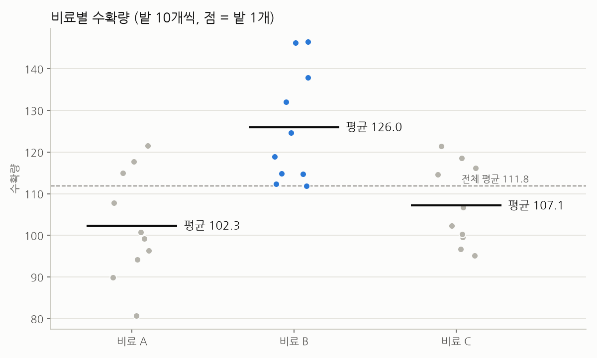
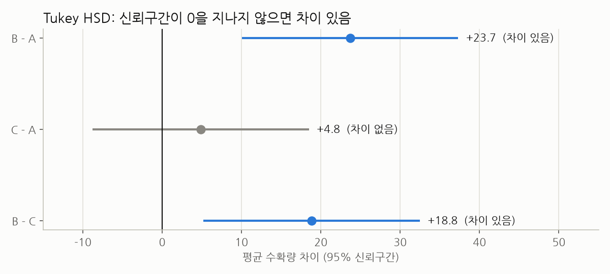
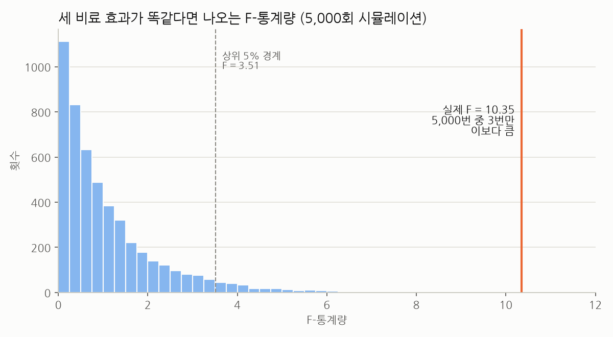

# 어떤 신규 비료가 가장 효과적일까?

> 통계 101×데이터 분석 (5-6장) 다양한 가설검정 · 문제 5 미니 프로젝트 발표 자료

---

## 한 줄 결론

**비료 B를 추천합니다.** B를 쓴 밭은 A보다 평균 23.7, C보다 18.8 더 수확했고, 이 차이는 우연으로 보기 어렵습니다. A와 C 사이에는 의미 있는 차이가 없습니다.

| 핵심 숫자 | 값 | 의미 |
|---|---|---|
| ANOVA p-값 | **0.0005** | 세 비료 중 적어도 하나는 다르다 |
| 사후분석 결과 | **B > A, B > C** | 다른 건 B뿐이다 (A ≈ C) |
| 시뮬레이션 | **5,000번 중 3번** | 효과가 같다면 이런 결과는 거의 안 나온다 |
| 효과 크기 (η²) | **0.43** | 수확량 차이의 약 43%가 비료 종류로 설명된다 |

---

## 1. 문제 상황

- 한 농업 연구소에서 새 비료 3종류(A, B, C)를 개발했습니다.
- 조건이 같은 밭 30개를 준비해 비료마다 10개씩 뿌리고 수확량을 쟀습니다.
- **알고 싶은 것:** 세 비료의 수확량에 진짜 차이가 있는지, 있다면 어떤 비료가 가장 좋은지입니다.

## 2. 데이터 살펴보기

| 비료 | 밭 수 | 평균 | 표준편차 | 최소 | 최대 |
|---|---|---|---|---|---|
| A | 10 | 102.3 | 13.0 | 80.7 | 121.5 |
| **B** | 10 | **126.0** | 13.8 | 111.9 | 146.5 |
| C | 10 | 107.2 | 9.7 | 95.1 | 121.4 |

- B 비료를 쓴 밭은 **10개 모두 전체 평균(111.8)보다 위**에 있습니다.
- A와 C는 점들이 많이 겹쳐 있어서 눈으로는 차이를 구분하기 어렵습니다.
- 다만 그래프만으로는 이 차이가 "진짜"인지 "우연"인지 판단할 수 없으므로, 통계 검정으로 확인했습니다.

## 3. 분석 방법

세 단계로 확인했습니다.

| 단계 | 방법 | 확인하는 질문 |
|---|---|---|
| ① | **분산분석 (ANOVA)** | 세 비료 중에 다른 게 하나라도 있나? |
| ② | **사후분석 (Tukey's HSD)** | 다르다면, 어떤 비료끼리 다른가? |
| ③ | **시뮬레이션 (5,000회)** | 효과가 똑같다면 이런 결과가 얼마나 자주 나오나? |

**ANOVA를 써도 되는지 미리 점검했습니다** (보고서 작성 시 추가 확인)
- 정규성(Shapiro-Wilk): A p=0.87, B p=0.09, C p=0.24 → 모두 0.05보다 커서 정규분포로 봐도 됩니다.
- 등분산성(Levene): p=0.61 → 세 그룹의 퍼진 정도가 비슷하다고 볼 수 있습니다.

## 4. 분석 결과

### ① 분산분석 (ANOVA)

- **가설**
  - H₀ (귀무가설): 세 비료의 평균 수확량은 모두 같다.
  - H₁ (대립가설): 적어도 하나는 평균 수확량이 다르다.
- **결과:** F-통계량 = 10.35, p-값 = 0.0005
- **해석:** p-값이 0.05보다 훨씬 작으므로 H₀를 기각합니다. → **세 비료 중 적어도 하나는 다릅니다.**
- 단, ANOVA는 "어딘가 다르다"까지만 알려줍니다. 그래서 어떤 비료끼리 다른지 알아보기 위해 사후분석을 진행했습니다.

### ② 사후분석 (Tukey's HSD)

| 비교 | 평균 차이 | 95% 신뢰구간 | 보정 p-값 | 결론 |
|---|---|---|---|---|
| B vs A | B가 **23.7** 높음 | 10.0 ~ 37.3 | 0.0006 | **차이 있음** ✅ |
| B vs C | B가 **18.8** 높음 | 5.2 ~ 32.5 | 0.0054 | **차이 있음** ✅ |
| C vs A | C가 4.8 높음 | -8.8 ~ 18.5 | 0.6569 | 차이 없음 ❌ |

- **읽는 법:** 막대(신뢰구간)가 **0을 지나지 않으면** "차이가 있다"고 봅니다.
- B와 비교한 두 막대(파란색)는 모두 0보다 오른쪽에 있습니다. → B가 확실히 높습니다.
- C vs A 막대(회색)는 0을 지나갑니다. → 차이가 0일 수도 있습니다.
- 보정 p-값(p-adj)은 비교를 세 번 하면서 생기는 "우연히 맞을 확률"을 감안해서 조정한 값입니다.

### ③ 시뮬레이션: "세 비료 효과가 똑같다면?"

- 30개 밭 전체의 평균(111.8)과 표준편차(15.8)를 가진 하나의 집단에서 10개씩 세 그룹을 뽑았습니다.
- 이렇게 **효과가 똑같은 가상 실험**을 5,000번 반복하면서 매번 F-통계량을 계산했습니다.

- 효과가 똑같으면 F-통계량은 대부분 0~2 사이에 몰리고, 상위 5%도 3.51 정도입니다.
- 실제 F-통계량 **10.35를 넘은 경우는 5,000번 중 3번(0.06%)** 뿐이었습니다.
- 공식으로 계산한 p-값(0.0005)과 시뮬레이션 p-값(0.0006)이 거의 같습니다. → 결과를 믿을 만합니다.

## 5. 결론 및 추천

**🌱 연구소에 비료 B를 추천합니다.**

1. 세 비료 중 평균 수확량이 가장 높습니다 (126.0).
2. A, C와의 차이가 통계적으로 유의미합니다 (p < 0.01).
3. 효과가 같다고 가정한 시뮬레이션에서도 이런 결과는 거의 나오지 않았습니다.

**B를 쓸 수 없다면?** A와 C는 수확량에 차이가 없으므로 **가격이 더 저렴한 쪽**을 고르는 것이 합리적입니다.

## 6. 한계와 개선 방향

| 한계 | 왜 문제인가 | 개선 방법 |
|---|---|---|
| 비료당 밭이 10개뿐 | 신뢰구간이 넓다 (B vs A: 10~37). A와 C의 작은 차이는 놓쳤을 수 있다 | 비료당 30개 이상으로 늘려 다시 실험 |
| 한 번, 한 장소에서 한 실험 | 그 해 날씨나 그 지역 흙에만 해당하는 결과일 수 있다 | 다른 지역·다른 해에 반복 실험 |
| 수확량만 비교 | 실제 도입은 비용과 환경도 중요하다 | 비료 가격, 토양 영향, 작물 품질도 함께 비교 |
| 연습용으로 만든 데이터 | 실제 밭에서 잰 값이 아니다 | 실제 데이터로 같은 절차를 적용 |

## 7. 용어 정리

| 용어 | 쉬운 설명 |
|---|---|
| 분산분석 (ANOVA) | 세 그룹 이상의 평균이 모두 같은지 한 번에 검사하는 방법 |
| F-통계량 | (그룹 사이 차이) ÷ (그룹 안 흩어짐). 클수록 그룹 간 차이가 뚜렷하다 |
| p-값 | "진짜 차이가 없다면" 이만큼 극단적인 결과가 나올 확률. 0.05보다 작으면 차이가 있다고 판단 |
| Tukey's HSD | ANOVA 후 어떤 그룹끼리 다른지 짝지어 비교하는 방법 |
| 신뢰구간 | 진짜 평균 차이가 있을 것으로 보이는 범위 |
| 효과 크기 (η²) | 전체 차이 중 그룹(비료) 때문에 생긴 비율. 0.14 이상이면 큰 편 |

---

*분석 도구: Python (scipy, statsmodels) · 원본 노트북: `[기초-실습] 통계 101x데이터 분석_ (5-6장) 다양한 가설검정.ipynb` 문제 5*
